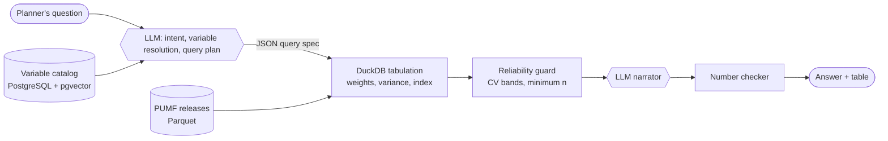

# PUMF Insights Assistant

A reference architecture for an AI assistant that answers plain-language questions about Canadians from Statistics Canada public use microdata files (PUMFs), with designs and cost estimates for **AWS** and **Google Cloud** in Canadian regions.

It follows the pattern Aided AI Assistant: an LLM translates the question into a validated query spec, and a deterministic engine computes every number.



## Design in five rules

1. **The LLM never produces a number.** It emits a JSON query spec ([schema](schemas/query-spec.schema.json)); DuckDB computes every estimate.
2. **The LLM never sees microdata.** It reads catalog metadata and receives finished, reliability-checked tables.
3. **Metadata is the product.** A curated variable catalog with universes, missing-value codes and bilingual labels ([DDL](sql/catalog.sql)) sets answer quality.
4. **Releases are immutable.** Every answer records the PUMF release, pipeline version, model and prompt versions.
5. **Reliability before readability.** CV and minimum-count rules from each release's user guide run before the narrator.

## AI governance

The [governance model](docs/ai-governance.md) maps every control to four frameworks. The Ontario Responsible Use of AI Directive is binding if an Ontario ministry or agency deploys the assistant; NIST AI RMF and ISO/IEC 42001 are voluntary; the federal Directive on Automated Decision-Making does not apply legally (no decisions about individuals) and is used as a benchmark.

## Data sources

- [Canadian Internet Use Survey PUMF](https://www150.statcan.gc.ca/n1/pub/56m0003x/56m0003x2020001-eng.htm) (2022, 2020, 2018): digital and media behaviour.
- [Census 2021 PUMF](https://www150.statcan.gc.ca/n1/en/catalogue/98M0001X), Individuals and Hierarchical files: population sizing and demographics.

They are separate samples and are never joined at respondent level; see [data-architecture.md](docs/data-architecture.md#7-analytical-serving) for how sizing combines them.

## Estimated monthly cost (CAD, November 2026)

| Tier | Questions/mo | AWS ca-central-1 | Google Cloud Toronto |
| --- | --: | --: | --: |
| Pilot | 1,000 | $673 | $514 |
| Production | 20,000 | $1,299 | $2,192 |
| Scale | 200,000 | $3,543 | $14,731 |

Includes dev and test environments. The gap is the model: keeping inference in Canada currently means Claude Haiku 5.5 via Bedrock's Canada cross-Region inference on AWS, or Gemini 3.5 Flash on Vertex AI's Montréal endpoint on Google Cloud. Line items, price basis and caveats: [docs/cost-estimate.md](docs/cost-estimate.md). Prices change; validate in each cloud's pricing calculator before budgeting.

## Repository contents

| Path | What it is |
| --- | --- |
| [docs/data-architecture.md](docs/data-architecture.md) | Full data architecture: zones, ingestion pipeline, catalog, serving, AI data flows, governance, operations, roadmap |
| [docs/aws-architecture.md](docs/aws-architecture.md) | AWS reference architecture diagram and notes |
| [docs/gcp-architecture.md](docs/gcp-architecture.md) | Google Cloud reference architecture diagram and notes |
| [docs/service-mapping.md](docs/service-mapping.md) | Component-by-component AWS ↔ Google Cloud mapping and LLM residency notes |
| [docs/cost-estimate.md](docs/cost-estimate.md) | Cost tables for three tiers, generated from the model |
| [docs/ai-governance.md](docs/ai-governance.md) | AI governance model: roles and RACI, life-cycle gates, human oversight, monitoring, change control, incidents, and a crosswalk to NIST AI RMF, ISO/IEC 42001, Ontario's Responsible Use of AI Directive and the federal DADM |
| [governance/](governance/) | Risk register (Markdown and CSV), system card, algorithmic impact self-assessment |
| [schemas/query-spec.schema.json](schemas/query-spec.schema.json) | JSON Schema for the LLM-to-engine contract, with an [example](schemas/query-spec.example.json) |
| [sql/catalog.sql](sql/catalog.sql) | PostgreSQL + pgvector DDL for the variable catalog, including hybrid search |
| [cost-model/](cost-model/) | Python cost model, Markdown generator and PDF builder |
| [pdf/](pdf/) | Generated PDF: architectures and cost estimate |

Variable codes in examples (such as `act_podcasts`) are illustrative placeholders, not real StatCan codes.

## Rebuilding the cost outputs

```bash
cd cost-model
pip install -r requirements.txt
python cost_model.py      # prints line items, writes costs.json
python gen_cost_md.py     # writes ../docs/cost-estimate.md
python build_pdf.py       # writes ../pdf/PUMF_Assistant_AWS_GCP_Architecture_Costs.pdf
```

Edit the tier assumptions, token counts and unit prices at the top of `cost_model.py`. Each line carries a basis flag: `S` confirmed from a November 2026 source, `L` published US list price scaled by a regional factor, `A` planning allowance.

## Status

Design and cost model only; no deployable infrastructure code yet. The catalog DDL has been tested on PostgreSQL 16 with the vector column stubbed; run it against a pgvector-enabled instance before use.

## Licence

[MIT](LICENSE). Statistics Canada data is not included; obtain PUMFs from Statistics Canada under their licence terms.
