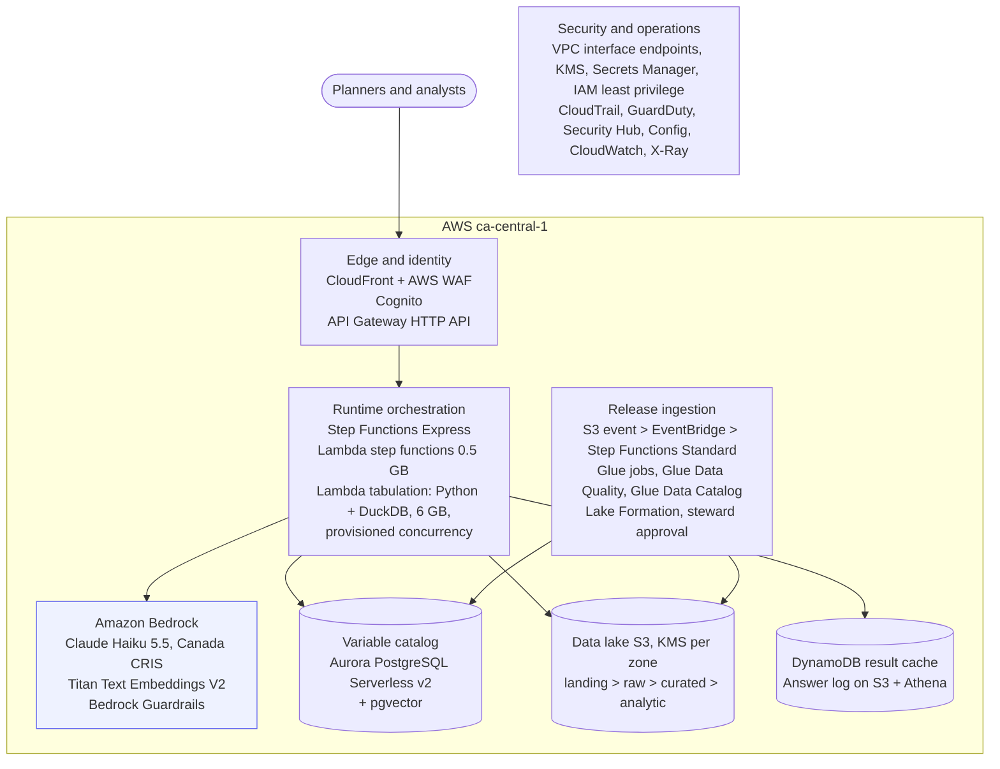

# AWS architecture

Region: ca-central-1 (Montréal). Production account, VPC across two Availability Zones, private subnets.

## Notes

- Claude Haiku 5.5 through Bedrock's Canada cross-Region inference keeps prompts in Canada (ca-central-1 / ca-west-1).
- Seven interface endpoints across two Availability Zones cost about CAD 160/month regardless of volume; they replace a NAT gateway and keep traffic private.
- Aurora Serverless v2 is the largest fixed cost. Dev and test clusters should use auto-pause (0 ACU).
- Provisioned concurrency keeps the 6 GB tabulation function warm so DuckDB answers in under 3 seconds.

Full detail: [data-architecture.md](data-architecture.md). Costs: [cost-estimate.md](cost-estimate.md).
