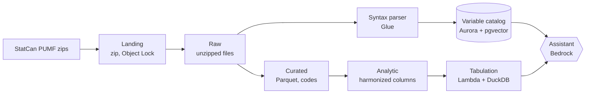
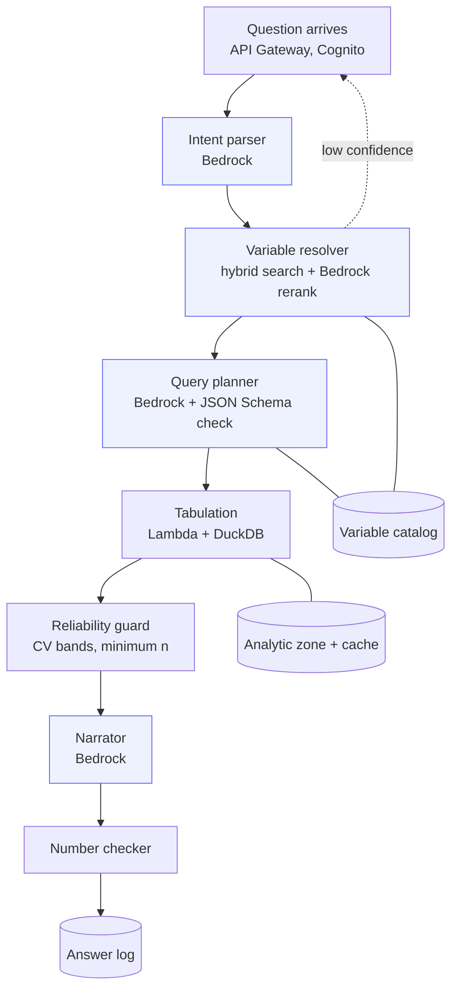
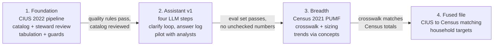

# Data architecture (AWS reference)

November 2026

This architecture lets a planner ask a plain-language question about Canadians' digital behaviour and get a weighted, reliability-checked crosstab and narrative, computed only from Statistics Canada public use microdata files (PUMFs). An LLM translates the question, and a deterministic engine does all of the math.

The Google Cloud equivalent of every component is in [service-mapping.md](service-mapping.md).

## 1. Purpose, scope and principles

**In scope:** ingestion of PUMF releases, a curated analysis store, a variable catalog with semantic search, a tabulation service, the data flows of the AI layer, governance and operations.

**Out of scope for v1:** a fused CIUS–Census respondent file, sub-provincial geography, user-uploaded data.

**Working assumptions**

- One AWS organization with separate dev, test and prod accounts.
- Primary region ca-central-1 (Montréal) for data residency.
- Users are analysts and planners, tens to low hundreds, not the public.
- Each source is a few hundred MB per release, so the design favours simplicity over big-data tooling.

**Design principles**

1. **The LLM never produces a number.** Every figure comes from the tabulation service; the LLM only chooses variables and writes text around returned results.
2. **Metadata is the product.** The quality of the variable catalog sets the quality of the answers.
3. **Immutable, versioned releases.** Each PUMF release lands once and is never overwritten; every answer records the release it used.
4. **Reliability before readability.** Sampling-variability and minimum-count rules run before the narrator sees a result.
5. **Serverless first.** Pay per query at low volume; move to containers only when latency or cost says so.



The assistant reads the catalog and receives finished tables from the tabulation service; it has no path to the data zones.

## 2. Source data

Two StatCan PUMF families feed v1: CIUS answers "what do people do online", and the Census answers "how many such people exist, and who are they". They are separate samples and are never joined at respondent level.

| Source | Unit and coverage | Role in the assistant | Weights | Notes |
| --- | --- | --- | --- | --- |
| [CIUS PUMF](https://www150.statcan.gc.ca/n1/pub/56m0003x/56m0003x2020001-eng.htm), 2022 (also 2020, 2018) | Individuals 15+ in the ten provinces | Behaviour: internet use, online activities, devices, e-commerce, social media | Person weight; bootstrap weights if shipped, to confirm per release | Earlier releases enable trends; questions change between cycles |
| [Census 2021 PUMF, Individuals File](https://www150.statcan.gc.ca/n1/en/catalogue/98M0001X) | 2.7% sample of anonymized census responses | Sizing and demographics | `WEIGHT`; the 2016 file also shipped replicate weights WT1–WT16, to confirm for 2021 | Household weight inherited by persons |
| [Census 2021 PUMF, Hierarchical File](https://www12-2021.statcan.gc.ca/census-recensement/2021/rt-td/families-familles-eng.cfm) | 1% of households with their members | Phase 2: household-level targets | Household weight | Released March 2024 |

**What arrives in each zip:** a fixed-width or CSV data file, a codebook (PDF), a user guide with sampling-variability tables, and SAS/SPSS/Stata syntax files. The syntax files carry column positions, variable labels and value labels, so they are the primary metadata source, with the PDF codebook as backup.

**Constraints that shape the design**

- PUMF geography is coarse, mostly province and some large CMAs, so the assistant cannot answer neighbourhood questions.
- Variables are top-coded and grouped for confidentiality, so value labels must be kept exactly as published.
- Licence and redistribution terms are read from each zip's licence file at ingestion and stored with the release record.

## 3. Accounts, environments and networking

The platform runs in a Control Tower landing zone with workloads isolated per environment, all pinned to ca-central-1 by service control policy (global services such as IAM excepted).

| Account | Holds | Key controls |
| --- | --- | --- |
| Management | AWS Organizations, Control Tower, billing | No workloads; SCPs deny regions other than ca-central-1 |
| Log archive | CloudTrail org trail, Config history, S3 access logs | Object Lock on log buckets; read-only to auditors |
| Security tooling | GuardDuty, Security Hub, IAM Access Analyzer, Macie | Delegated admin for the org |
| Data dev / test | Full stack with synthetic or prior-release data | Developers have write access; no prod data |
| Data prod | S3 lake, Glue, Aurora, Lambda, Bedrock access, API | Deploys through CI only; break-glass role for incidents |

**Network layout (prod)**

- One VPC across Availability Zones, private subnets only for compute and Aurora; no internet gateway on the data subnets.
- Gateway endpoint for S3; interface endpoints for Bedrock runtime, Glue, Secrets Manager, KMS, STS, CloudWatch Logs and Step Functions.
- Lambdas that read Aurora run inside the VPC; API Gateway is the only public entry point, fronted by CloudFront and AWS WAF.

**Getting files in:** PUMF zips are downloaded by an operator from StatCan's file transfer service, or by a small download Lambda in a separate egress-only subnet, then written to the landing bucket.

**Infrastructure as code:** AWS CDK or Terraform, one stack per layer (network, storage, catalog, pipelines, serving, AI), promoted dev → test → prod with a manual approval before prod.

## 4. Storage zones

| Zone | Bucket and path pattern | Contents | Format | Retention and protection |
| --- | --- | --- | --- | --- |
| Landing | `pumf-prod-landing/statcan/{product}/{release}/` | The zip as received, plus a SHA-256 manifest | ZIP | Kept forever; S3 Object Lock (governance mode) |
| Raw | `pumf-prod-raw/{survey}/{release}/` | Unzipped data file, syntax files, codebook, user guide, licence | As published | Kept forever; write-once by the ingest role |
| Curated | `pumf-prod-curated/{survey}/microdata/release={release}/` | One row per respondent, original StatCan codes, typed columns, all weights | Parquet, Zstandard | Kept forever; read by the tabulation role |
| Analytic | `pumf-prod-analytic/{survey}/release={release}/` | Curated rows plus harmonized demographic columns and approved derived variables; base marginals | Parquet, Zstandard | Rebuilt per pipeline version; old builds kept 90 days |
| Exports | `pumf-prod-exports/{user_hash}/{yyyy}/{mm}/` | Tables, charts and decks users download | CSV, PNG, PPTX | Lifecycle delete after 30 days |

**Conventions**

- Column names are the StatCan variable codes, lower-cased, never renamed; human labels live only in the catalog. Harmonized columns take an `h_` prefix (`h_age_band`, `h_province`).
- Each release is a separate partition, so a query names the release explicitly and results stay reproducible.
- Apache Iceberg is optional: releases are immutable, so plain Parquet with partitions is enough.
- Bucket policies deny non-TLS access and any principal outside the account; Block Public Access is on.

## 5. Ingestion and transformation pipeline

One Step Functions state machine, `pumf-release-ingest`, takes a new zip from landing to a published release in 13 steps; nothing becomes visible to users until a data steward approves.

| # | Step | AWS service | Output | On failure |
| --- | --- | --- | --- | --- |
| 1 | Trigger on new zip in landing | S3 event → EventBridge | Execution started | — |
| 2 | Verify checksum, register release as `ingesting` | Lambda | Row in `release` | Stop, alert |
| 3 | Unzip to raw zone | Lambda | Raw files | Stop, alert |
| 4 | Parse SAS/SPSS syntax for positions and labels | Glue Python shell | Staged metadata JSON | Fall back to manual codebook entry |
| 5 | Convert to typed Parquet | Glue job (pyarrow or DuckDB) | Curated partition | Stop, alert |
| 6 | Validate data | Glue Data Quality | Quality report | Stop on blocking rule |
| 7 | Load variables, values, universes | Lambda → Aurora | Catalog rows | Roll back the release's rows |
| 8 | Draft descriptions and synonyms | Lambda → Bedrock | Rows flagged `machine_drafted` | Continue; mark for review |
| 9 | Embed search text | Lambda → Bedrock embeddings | Vectors in pgvector | Retry, then stop |
| 10 | Apply crosswalk, build analytic zone, base marginals | Glue job | Analytic partition | Stop, alert |
| 11 | Register tables, apply grants | Glue Data Catalog, Lake Formation | Queryable release | Stop, alert |
| 12 | Run the golden-question evaluation set | Step Functions map over Lambda | Pass/fail report | Block publish |
| 13 | Steward approval, flip release pointer to `published` | Task token + Lambda | Release live | Stays `staged` |

**Blocking quality rules in step 6**

- Record count equals the count stated in the PUMF user guide.
- Sum of the final weight is within 0.5% of the population total the guide reports.
- Every coded value appears in that variable's value labels.
- Weights are positive and non-null; bootstrap weights have the expected number of columns.

## 6. Metadata and semantic layer

Aurora PostgreSQL with pgvector holds the semantic catalog the assistant searches; the Glue Data Catalog holds only physical schemas. DDL: [`../sql/catalog.sql`](../sql/catalog.sql).

| Table | Grain | Purpose |
| --- | --- | --- |
| `survey` | One per source | CIUS, Census individuals, Census hierarchical |
| `release` | One per survey release | The `published` flag the assistant reads |
| `variable` | One per code per release | The searchable variable tree, with embedding |
| `value_label` | One per code value | Labels plus valid skip, don't know, refusal, not stated |
| `concept` / `concept_variable` | Logical concept across releases | Trends across cycles |
| `harmonized_dim` / `crosswalk` | Source code → shared code | Same target definition in CIUS and Census |
| `derived_variable` | One per approved derivation | Steward-approved recodes |
| `saved_target` | One per saved audience | Reusable audiences |

- **Universe as data:** `universe_expr` stores who was asked in the query-spec filter syntax; the planner adds it to the base and the resolver rejects questions about people never asked.
- **Missing codes are first-class:** valid skips and non-response are excluded from denominators by default.
- **Hybrid retrieval:** pgvector similarity plus PostgreSQL full-text search, merged with reciprocal rank fusion and filtered to the published release. Exact code matches always win.
- **Steward workflow:** machine-drafted descriptions start as `draft`; approved rows are re-embedded and shown to users.

## 7. Analytical serving

A containerized Lambda running Python with DuckDB turns a validated query spec into weighted estimates, variances and indexes. Athena stays off the hot path and serves analysts' ad hoc SQL.

- Lambda container, 4–10 GB memory, provisioned concurrency to avoid cold starts; release Parquet cached in `/tmp`.
- Target: p95 under 3 seconds for a crosstab of up to two row variables by one column variable, including variance.

**Estimates**

```
N_rc     = sum over i in base of w_i * 1[r_i] * 1[c_i]
p_r|c    = N_rc / N_c
Index_rc = 100 * p_r|c / p_r|base
```

**Variance:** with bootstrap or replicate weights, re-estimate once per replicate (an n × B matrix multiply) and combine with the formula in that release's user guide; otherwise use the guide's approximate sampling-variability tables, loaded into `cv_lookup`.

**Sizing across surveys:** CIUS rate × Census count within harmonized cells (age band × sex × province), labelled as model-based estimates and never mixed with direct estimates.

**Result cache:** DynamoDB, keyed by SHA-256 of the canonical spec plus `release_id`; no TTL needed because releases never change.

## 8. AI layer data flows

Four of the eight runtime steps call Bedrock, and none of them can read microdata.



| Step | Input | Output | Validated by |
| --- | --- | --- | --- |
| Intent parser | Question, chosen survey, saved targets | Intent JSON | JSON Schema |
| Resolver rerank | Intent plus top 20 catalog candidates per concept | Ranked codes with confidence | Codes must exist in the published release |
| Query planner | Intent plus chosen variables' metadata | Query spec JSON | [JSON Schema](../schemas/query-spec.schema.json), catalog lookup, universe check |
| Narrator | Result table with flags, spec, labels | Narrative and chart choice | Number checker |

**Clarify instead of guess:** when the top candidate's confidence is low or two candidates are close, the run pauses and offers up to four choices; the pick becomes a synonym suggestion for the steward.

**The query spec contract** is the only thing that crosses from the AI layer to the analytical layer. Example: [`../schemas/query-spec.example.json`](../schemas/query-spec.example.json).

**Answer log:** one row per question (spec, release, pipeline version, catalog version, model and prompt versions, result hash, flags, narrative, checker outcome, latency, feedback), partitioned by month and queried with Athena.

## 9. Governance, security and quality

The full AI governance model, risk register and system card are in [ai-governance.md](ai-governance.md).

No role that calls an LLM can read microdata; only aggregated, reliability-checked tables reach Bedrock.

| Role | Can read | Can write | Cannot |
| --- | --- | --- | --- |
| `ingest-pipeline` | Landing, raw | Raw, curated, analytic, catalog | Invoke the assistant API |
| `tabulation-service` | Analytic zone, `cv_lookup`, `tab_cache` | `tab_cache` | Call Bedrock, read raw or landing |
| `assistant-orchestrator` | Catalog (published only), answer log | Answer log | Read any S3 data zone |
| `bedrock-invoker` | — | — | Anything but `bedrock:InvokeModel` on approved models |
| `data-steward` | Catalog and quality reports | Labels, approvals, release status | Delete releases |
| `analyst` | Curated and analytic via Athena | Athena results bucket | Raw, landing, catalog edits |

**Reliability rules** (cut-offs stored per release from its user guide; the guide always wins):

| CV of the estimate | Treatment |
| --- | --- |
| Under 16.6% | Shown normally |
| 16.6% to 33.3% | Shown with a "use with caution" flag; the narrator must say so |
| Over 33.3%, or n under the guide's minimum | Suppressed; the narrator explains and suggests a broader base |

**AI governance evidence:** evaluation results, model and prompt versions, a risk register and a system card are kept as release artifacts, mapping to the NIST AI RMF Measure and Manage functions and ISO/IEC 42001 operational controls.

**User data:** user IDs hashed in logs; answer logs kept 13 months; exports deleted after 30 days.

## 10. Operations

- **Observability:** X-Ray traces per question; CloudWatch metrics for latency, resolver confidence, clarify rate, suppression rate, number-checker failures and cache hits.
- **Evaluation set:** 150–200 golden questions with expected specs, run on every prompt change, model change and new release.
- **Release runbook:** download to landing, let the pipeline run, review quality and evaluation reports, review drafted metadata, link concepts for trends, approve.

**Roadmap**



## Sources

- [Canadian Internet Use Survey – Public Use Microdata File](https://www150.statcan.gc.ca/n1/pub/56m0003x/56m0003x2020001-eng.htm), Statistics Canada
- [CIUS PUMF dataset record](https://open.canada.ca/data/en/dataset/7e9fe4e5-d311-43d9-a385-57603ef1de1b), Open Government Portal
- [Census of Population: Public Use Microdata Files (98M0001X)](https://www150.statcan.gc.ca/n1/en/catalogue/98M0001X), Statistics Canada
- [Census PUMF 2021 catalog entry: sampling and weighting](https://microdata.unhcr.org/index.php/catalog/1007), UNHCR Microdata Library
- [Notes on the 2016 Individuals PUMF weights](https://iter.ca/post/individuals-pumf/)
