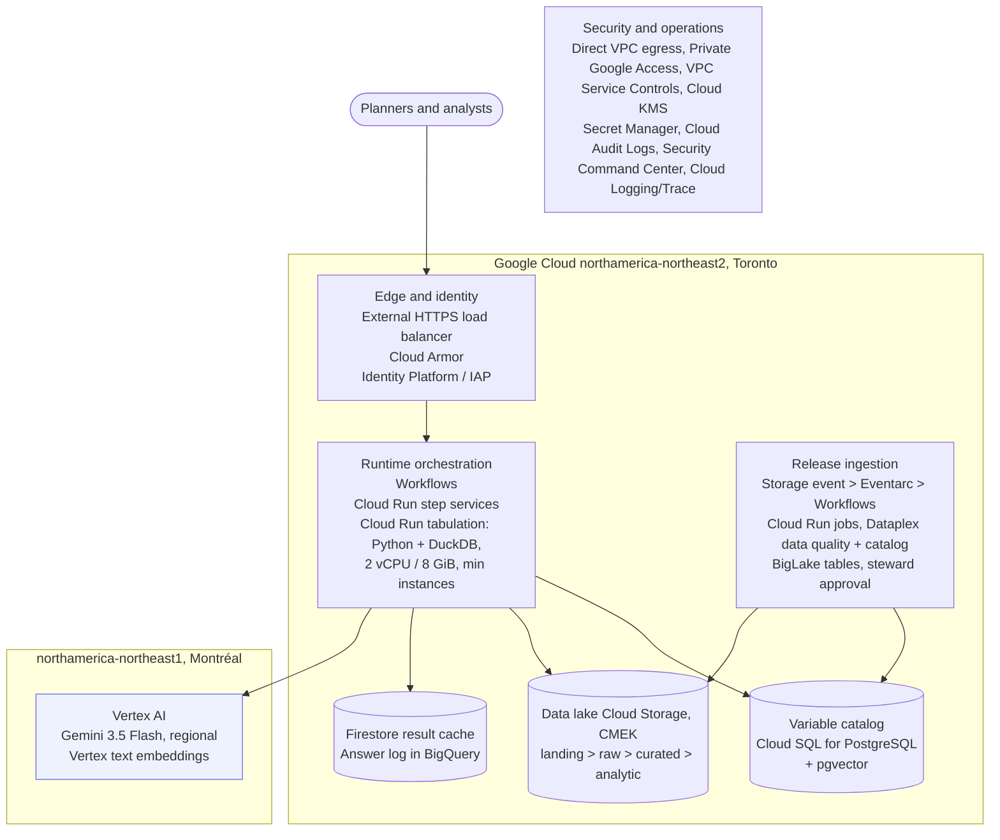

# Google Cloud architecture

Region: northamerica-northeast2 (Toronto), with LLM calls to the Vertex AI endpoint in northamerica-northeast1 (Montréal). Production project in a Shared VPC.

## Notes

- Gemini 3.5 Flash is listed with ML processing in Montréal; calls cross from Toronto to Montréal but stay in Canada.
- Toronto is a Tier 2 region for Cloud Run, about 40% above Tier 1 prices; compute is still a small share of cost.
- Direct VPC egress and Private Google Access avoid the per-endpoint hourly fees AWS charges.
- Cloud SQL has no scale-to-zero; the pilot uses a 1 vCPU instance without HA, adding HA at production.

Full detail: [data-architecture.md](data-architecture.md). Costs: [cost-estimate.md](cost-estimate.md).
