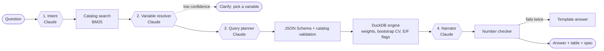

# Reference implementation

A minimal, runnable version of the PUMF Insights Assistant. It answers plain-language questions about a survey release with weighted, reliability-flagged tables. Claude interprets the question and writes the narrative; DuckDB computes every number.

It runs on a laptop with a **synthetic CIUS-style release** (6,000 invented respondents, 50 bootstrap weights). The data has the same shape as a Statistics Canada PUMF, so the same ingest code reads a real PUMF.



## Quick start

```bash
cd reference-implementation
python -m venv .venv && source .venv/bin/activate
pip install -e ".[dev]"

pumfai setup                      # ingest the synthetic release (quality rules run here)
pytest                            # 31 tests, no API key needed

export ANTHROPIC_API_KEY=sk-ant-...
pumfai ask "What share of Ontarians aged 25 to 44 listen to podcasts, by income?"
pumfai serve                      # API on http://localhost:8000/docs
pumfai eval                       # golden set: 22 questions, prints accuracy
```

Without an API key you can still search the catalog and run specs directly:

```bash
pumfai search "online shopping"
pumfai tabulate examples/podcasts_ontario_by_age.json
```

## What each part does

| Module | Role | Architecture doc section |
| --- | --- | --- |
| `synthetic.py` | Generates the invented release: fixed-width data, SPSS syntax, bootstrap weights, steward overlay, user-guide metadata | 2. Source data |
| `spss.py` | Parses PUMF SPSS syntax: column positions, implied decimals, variable and value labels, missing-value codes (6/7/8/9 → valid skip, don't know, refusal, not stated) | 5. Ingestion, step 4 |
| `ingest.py` | Blocking quality rules, Parquet output, harmonized `h_` columns, `catalog.json` | 5. Ingestion, steps 5–10 |
| `catalog.py` | Variable catalog with BM25 search; exact code matches first | 6. Metadata layer |
| `spec.py` | Validates the query spec against the [JSON Schema](../schemas/query-spec.schema.json) and the catalog | 8. Query spec contract |
| `engine.py` | Weighted counts, column and row percentages, index, bootstrap SE and CV, E/F reliability flags; suppressed values are withheld | 7. Analytical serving |
| `prompts.py` | The four prompts and tool schemas, versioned by `PROMPT_VERSION` | 8. AI layer |
| `llm.py` | Anthropic client using strict tools with `tool_choice: auto`; one retry if the model doesn't call the tool | 8. AI layer |
| `checker.py` | Rejects any percentage, gap, count or index in the narrative that isn't in the table | 8. AI layer |
| `pipeline.py` | Orchestration, clarify loop, planner retry with validation errors, template fallback, JSONL answer log | 8, 9 |
| `api.py` | FastAPI: `POST /ask`, `POST /tabulate`, `GET /variables`, `GET /health` | 8 |
| `evaluate.py` | Golden-set scoring: status accuracy, exact spec match, row recall, checker pass rate, clarify rate | Governance: section 7 |

## API

```bash
curl -s localhost:8000/ask -H 'content-type: application/json' \
  -d '{"question": "Video streaming by income quintile"}'
```

`/ask` returns one of four statuses:

- `answered`: `answer`, `table_markdown`, `spec`, `result` and a `trace` with intent, candidates, selections, model calls with token counts, checker outcome and prompt version.
- `clarify`: options per ambiguous phrase. Resend the question with `"choices": {"<phrase>": "<code>"}`.
- `unsupported`: the survey can't answer it (city-level geography, trends, topics not covered).
- `error`: the planner couldn't produce a valid spec after one retry.

Every call appends a record to `logs/answers.jsonl`.

## Reliability flags

Following StatCan convention, cells carry **E** (use with caution, CV between 16.6% and 33.3%) or **F** (too unreliable: CV over 33.3% or an unweighted denominator under 30). F values are removed from the result before the narrator sees it, so they can't be quoted. The thresholds come from each release's `user_guide.json`; set them from the real PUMF user guide when you load one.

## Using a real PUMF

1. Put the PUMF's fixed-width data file and SPSS syntax file in `data/raw/<release_id>/`.
2. Write `user_guide.json` with the record count, weight total, weight and bootstrap variable names, and reliability rules from the PUMF user guide.
3. Write `steward_overlay.json` with topics, question text, universes (`universe_expr`), synonyms and the harmonized crosswalk. This is the steward's work and the biggest driver of answer quality.
4. Run `PUMFAI_RELEASE=<release_id> pumfai ingest`, then extend `golden/questions.jsonl` with questions about the new data.

Check the PUMF's licence before committing any of its files to a repository.

## Configuration

See `.env.example`. The defaults are `claude-haiku-5-5` for all four steps. `PUMFAI_PLANNER_MODEL` can route only the planner to a stronger model, such as `claude-sonnet-5-5`.

## Limits of this minimal version

- One survey and one column variable per table; no Census sizing (`model_based_sizing` is rejected).
- Keyword search instead of hybrid vector search; production uses [`sql/catalog.sql`](../sql/catalog.sql).
- No authentication, rate limiting or user interface beyond the OpenAPI docs page.
- Tests use scripted models, so they check the plumbing, not model quality. The golden set (`pumfai eval`) measures quality with a real model.
